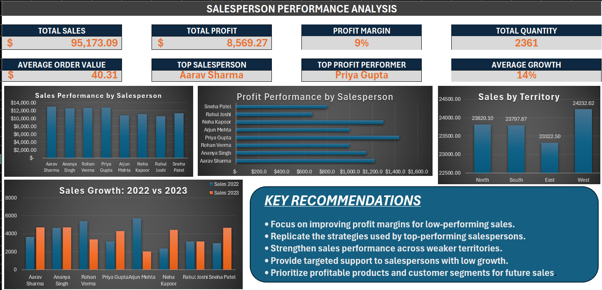

# 📊 VEDA Technology – Day 27: Salesperson Performance Analysis

## 📌 Project Overview

This project focuses on analyzing salesperson performance using sales transaction data in Microsoft Excel.

The dashboard provides a clear view of sales, profit, profitability, quantity, growth, salesperson rankings, and territory-wise performance to support data-driven business decisions.

---

## 🎯 Objectives

- Analyze salesperson-wise sales performance.
- Evaluate total sales and total profit.
- Calculate profit margins.
- Compare salesperson performance across territories.
- Analyze sales growth between 2022 and 2023.
- Identify top-performing salespersons.
- Rank salespersons based on sales and profit.
- Provide actionable business recommendations through an interactive Excel dashboard.

---

## 🛠️ Tools & Technologies

- Microsoft Excel
- Excel Tables
- Excel Formulas
- Data Analysis
- Data Visualization
- Dashboard Design

---

## 📂 Dataset

The analysis is based on a retail sales transaction dataset containing information such as:

- Order ID
- Order Date
- Ship Date
- Customer Name
- Segment
- Country
- City
- State
- Region
- Product Category
- Sub-Category
- Product Name
- Sales
- Quantity
- Discount
- Profit

The original dataset did not contain salesperson information. Therefore, an **analytical salesperson allocation** was created for performance-analysis purposes.

---

## 👥 Salesperson & Territory Analysis

Eight salespersons were assigned for analytical segmentation:

| Salesperson | Territory |
|---|---|
| Aarav Sharma | North |
| Ananya Singh | South |
| Rohan Verma | East |
| Priya Gupta | West |
| Arjun Mehta | North |
| Neha Kapoor | South |
| Rahul Joshi | East |
| Sneha Patel | West |

> **Note:** Salesperson and territory assignments are analytical allocations created for this project and do not represent original source-data employee records.

---

## 📈 Key Analysis Performed

### 1. Sales Performance
Calculated total sales for each salesperson to identify high-revenue contributors.

### 2. Profit Performance
Analyzed total profit and compared profitability across salespersons.

### 3. Profit Margin
Calculated profit margin using:

**Profit Margin % = Total Profit / Total Sales × 100**

### 4. Salesperson Ranking
Salespersons were ranked based on:

- Total Sales
- Total Profit

### 5. Year-over-Year Growth
Compared salesperson sales between 2022 and 2023.

**Growth % = (2023 Sales − 2022 Sales) / 2022 Sales × 100**

### 6. Territory Performance
Compared total sales across:

- North
- South
- East
- West

---

## 📊 Dashboard

The Excel dashboard contains:

- 💰 Total Sales
- 📈 Total Profit
- 📊 Profit Margin
- 📦 Total Quantity
- 🧾 Average Order Value
- 🏆 Top Salesperson
- ⭐ Top Profit Performer
- 📈 Average Growth
- Sales Performance by Salesperson
- Profit Performance by Salesperson
- Sales Growth: 2022 vs 2023
- Sales by Territory
- Key Recommendations

### Dashboard Preview



---

## 💡 Key Recommendations

- Focus on improving profit margins for low-performing sales.
- Replicate strategies used by top-performing salespersons.
- Strengthen sales performance across weaker territories.
- Provide targeted support to salespersons with low growth.
- Prioritize profitable products and customer segments for future sales.

---

## 📁 Project Structure

```text
Veda-technology-task-27-Salesperson-Performance-Analysis/
│
├── VEDA_Technoogy_Task_27_Salesperson_Performance_Analysis.xlsx
├── salesperson-performance-dashboard.png
└── README.md
